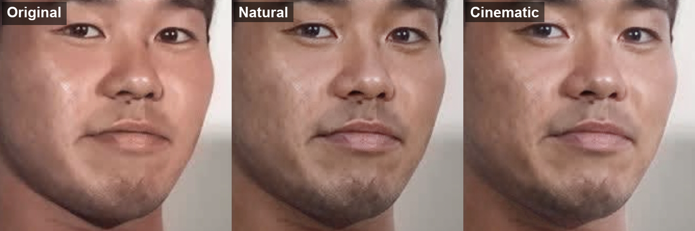
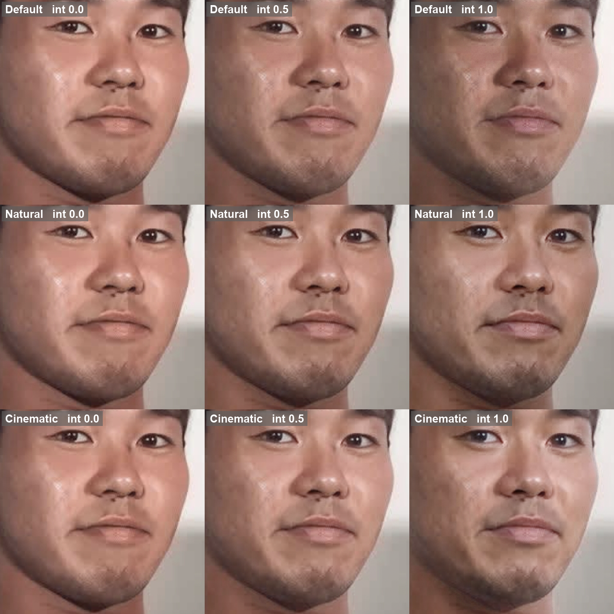

# Neural Render (neural-render-ts)

Apply NVIDIA DLSS to **images and video** on Windows — DLSS Super Resolution (upscaling),
DLSS Frame Generation (higher frame rate) and DLSS Neural Rendering ("DLSS 5", NGX feature 18) —
driven from **Bun + TypeScript** through `bun:ffi` over Direct3D 12 and NVIDIA NGX, with a
**React + Material UI** web front end. The Super Resolution, Frame Generation and Neural Rendering
runtimes are version-switchable (DLSS-Swapper style).



<sub>DLSS Neural Rendering (NGX feature 18) on a real photo — 100% crop: Original vs. the Natural and Cinematic styles.</sub>



<sub>Rows top→bottom: style Default / Natural / Cinematic. Columns left→right: intensity 0.0 / 0.5 /
1.0 (0.0 = original).</sub>

> **Status.** Runs on the project's RTX 5090. The **web UI** covers the whole pipeline — SR
> upscaling, Neural Rendering, Frame Generation, DLSS version selection and browser upload. The
> **command line** covers the probe, SR and NR on PNG images, any of SR, NR and Frame Generation on a
> video in one pass, and the version list. See [Feature status](#feature-status) below.

---

## Requirements

- **Windows 11**, an **NVIDIA RTX GPU** (developed on an RTX 5090) with a current driver.
- **[Bun](https://bun.sh)** (project uses `@types/bun` ^1.4).
- **NVIDIA DLSS runtime DLLs** placed under `runtime/` (see [Runtime folder](#runtime-folder)).
  These are **not** redistributed — you supply your own licensed copies.
- **ffmpeg / ffprobe** for video: found through `FFMPEG_PATH` / `FFPROBE_PATH`, then `PATH`, then
  `runtime/ffmpeg/bin` (place your own build there) and the folders the common installers use, such as
  the one `winget install Gyan.FFmpeg` fills. Without both tools a video job fails when it starts.

## Install & run

```bash
bun install
bun run dev              # start server at http://localhost:4080
bun run typecheck        # tsc --noEmit
bun test                 # unit suite (pure logic, no GPU)
bun run cli <command>    # see CLI reference below
```

Server env vars: `PORT` (default **4080**), `NR_HOST` (default **127.0.0.1**, loopback only: the API
has no authentication), `NR_RUNTIME_DIR` (default `<repo>/runtime`; the CLI ignores it and uses
`<repo>/runtime` unless given `--runtime`), `NODE_ENV=production` (turns dev mode off).
`NR_APPDATA` (default `<repo>/logs`) is the folder NGX writes its logs to (frame generation's go in its
`ngx/` subfolder), for the server and every CLI command alike; the server stores uploads in its `uploads/`
subfolder.

---

## Command line

| Command | What it does |
| --- | --- |
| `probe` | Inspect GPU / driver / NGX core / `runtime/`; exits 0 only when neural rendering is ready. It does not test frame generation. |
| `sr <in.png> [out.png]` | **DLSS Super Resolution (feature 1)** — real PNG upscaling. |
| `nr <in.png> [out.png]` | **DLSS Neural Rendering (feature 18)** — enhance a PNG at the same size. |
| `video <in> [out] [--sr] [--nr] [--fg]` | **Any of SR, NR and Frame Generation on a video in one pass**, in that order, then encode — the web UI's video job. |
| `fg <in> [out.mp4]` | **DLSS Frame Generation (feature 11)** — interpolate to higher frame rate. |
| `versions` | List every installed DLSS runtime DLL per feature. |
| `forwarder` | (Re)generate the `nvngx.dll` shim NGX requires. |
| `help [command]` | Overview or per-command help. |

### Key options

- **`sr`** — `--factor N` (2, 1–8; the output is the source size × N, each side rounded to even, as in
  an image job, and at most 8192 pixels per side; DLSS runs in the mode whose ratio is nearest: 1.00 DLAA,
  1.50 MaxQuality, 1.72 Balanced, 2.00 MaxPerf, 3.00 UltraPerformance), `--warmup N` (4, 0–64; extra passes
  over the image, as an image job runs them), `--preset NAME` (L; model preset), `--dlss-version VER`;
  writes `<input>.sr.png` by default
- **`nr`** — `--intensity F` (1, 0–2; no further effect above 1), `--style N` (0; Default / Natural / Cinematic),
  `--local-tone F` (1, 0–2), `--local-structure F` (1, 0–2), `--auto-mask`, `--warmup N` (4, 0–64; as for
  `sr`). `--preset`, `--skin-structure` and `--ui-correction` are accepted but ignored by `nvngx_dlssnr.dll` 310.8.2.0.
  `--stack N` (1, whole number 1–4) runs Neural Rendering N times, each pass on the previous pass's output,
  for a stronger look than `--intensity` reaches; each pass adds about 1.1 GB of GPU memory at 4K and its
  time. Writes `<input>.nr.png` by default, `<input>.nrx3.png` with `--stack 3`.
- **`video`** — one switch per step, run in this order whatever order they are given in: `--sr` upscales
  every frame with DLSS Super Resolution, `--nr` enhances every frame at the output size with DLSS Neural
  Rendering, `--fg` interpolates the result with DLSS Frame Generation. With none, the video is only
  re-encoded. `--factor N` or `--size WxH` set the output size: with `--sr`, Super Resolution upscales to
  it (1–8, at most 8192 pixels per side; 1.5 by default); without it, the decode resizes to it with lanczos
  (0.25–8; default: the source size). Each step's options apply only with its switch, and the command
  refuses them otherwise: `--motion none|flow` (none; flow gives Super Resolution motion vectors) and
  `--sr-version VER` with `--sr`; the `nr` look options, `--stack N` and `--nr-version VER` with `--nr`; `--fps`,
  `--multiplier`, `--fg-path auto|native|cascade` (`fg`'s `--engine`) and `--fg-version VER` with `--fg`.
  `--codec NAME` and `--quality N` (as for `fg`), `--container mp4|mkv|mov` (mp4; `--fg` writes mp4
  only), `--no-audio`. Writes `<input>.<steps>.<container>` by default, e.g. `clip.sr-nr-fg.mp4` (or
  `clip.sr-nrx3-fg.mp4` with `--stack 3`), or `clip.resize.mp4` and `clip.copy.mp4` without a step. A
  stacked `--nr` alone encodes through the threaded pipeline, not the GPU-resident NVENC path a single pass
  takes. The command line goes through the same request
  validation as `POST /api/jobs`.
- **`fg`** — `--fps RATE` (a named rate from 23.976 to 480, or an exact `num/den`; default: source fps
  × `--multiplier`), `--multiplier N` (2, whole number 1–16; used when `--fps` is absent),
  `--engine auto|native|cascade` (auto, see below), `--codec NAME` (h264, hevc or av1 on the CPU, or
  h264_nvenc, hevc_nvenc or av1_nvenc on the GPU, which take at most 4096, 8192 and 8192 pixels per side;
  h264_nvenc by default, or its CPU codec of the same format, h264, when NVENC cannot start or the output
  is larger), `--quality N` (0–51, lower = better, 20), `--dlss-version VER` (an installed Frame Generation
  version; `310.7.129.0`, `310.7.0.0` and `310.6.0.0` were measured to load and run 2× on an RTX 5090);
  writes `<input>.fg.mp4` by default, the name `video --fg` gives it

Frame generation (`fg`, `video --fg` and the Path selector in the web UI): `auto` runs one native DLSS session when
output ÷ source is an exact integer from 2× up to the runtime's MultiFrameCountMax + 1 (measured: 6×
with `nvngx_dlssg.dll` 310.7.129 on an RTX 5090) and, from 3× up, Windows hardware-accelerated GPU
scheduling (HAGS) is on (Settings > System > Display > Graphics > Default graphics settings, then
reboot). Otherwise it chains 2× stages (1 for 2×, 2 for 4×, else 3) and places the nearest frame on each
output instant; when the runtime generates nothing in a native 3×+ session, `auto` re-runs the job that
way. `native` and `cascade` force a path, and `native` fails, writing no output, when the ratio is not an
exact integer in range. A target at or below the source rate generates nothing: the video is only
resampled. The output keeps the source duration and its first audio track (re-encoded to AAC, 192 kb/s).

**Shared options.** `--adapter N` (GPU index from `probe`) applies to `probe`, `sr`, `nr` and `video`, where
it picks the GPU for Super Resolution and Neural Rendering; `--runtime DIR` to `probe`, `sr`, `nr`, `video`,
`fg` and `versions`. Every command except `help` rejects unknown flags; per-command `--help` lists all
options with defaults. Frame generation has no GPU choice, in the CLI or the web UI: it takes the NVIDIA
GPU with CUDA and the most VRAM, and its NVENC and NVOFA helpers use CUDA device 0, which on a machine
with more than one NVIDIA GPU can be another device; `video --fg` alone therefore refuses `--adapter`.

**Exit status.** 0 when the command succeeds; 1 when the run fails (`probe`: neural rendering is not
ready); 2 when the command line is wrong — an unknown command or option, an argument the command does not
take, a value an option does not accept (an `fg --fps` that is not a rate, an `sr --dlss-version` that is
not installed), or a missing input argument. An input file that does not exist, or that is not a PNG for
`sr`/`nr`, fails the run: 1.

---

## Web UI

At **http://localhost:4080/** — no separate build step (Bun serves `web/index.html`).
For front-end-only work: `bun run web/mock-server.ts` on port 3080, or append `?mock=1`. Each step is a
card with its own switch, numbered in the order the steps run, and shows its settings while it is on. Once
the input is chosen, the form reads the source's size, rates, length, codec and audio, shows what each step
makes of them, and sums the job up in a plan line above Run, with the name of the file it writes. A setting
the job does not use says why: with Super Resolution on, the resize gives way to the output size Super
Resolution sets.

**Image tab** — PNG input only; Super Resolution (only enlarges, to at most 8192 pixels per side; the
source size runs DLAA) and Neural Rendering (look controls, and a stack of 1–4 passes), each with its own DLSS version; a resize
when Super Resolution is off; before/after compare.  
**Video tab** — the same two steps, plus optical-flow motion for Super Resolution, then Frame
Generation to 23.976–480 fps or a multiple of the source rate (auto / native / cascade) with its own DLSS
version; a lanczos resize when Super Resolution is off, and NVENC encoding (H.264, CQ 20 by default) or CPU
encoding. NVENC takes at most 4096 pixels per side for H.264 and 8192 for HEVC and AV1 (measured on an RTX
5090); a larger output, or a GPU where NVENC cannot start, encodes the same format on the CPU instead, and the
form says so before the job runs. With Frame Generation on, the output is always mp4.  
**Jobs tab** — live job list with progress, the steps each job runs, log tail and cancel.  
**Settings tab** — GPU for Super Resolution and Neural Rendering (stored by CUDA device UUID; frame
generation ignores it), image warm-up passes (0–64, default 4), stored settings reset.  
**Probe tab** — hardware/runtime check (adapters, CUDA device, optical-flow limits, DLLs, shim).

### Caveats

- A **CUDA device is required**; non-NVIDIA or duplicate DXGI entries are rejected.
- Alternate DLSS DLLs may fail to initialise on newer drivers; the job reports a clear error.
- NR style, intensity (effective to 1), local tone/structure, and auto mask apply; model preset
  and skin structure are shown disabled and UI correction is not offered, because
  `nvngx_dlssnr.dll` 310.8.2.0 ignores them.

## HTTP API

Same-origin; JSON requests and responses unless a row says otherwise:

| Method & path | Returns |
| --- | --- |
| `GET /api/probe` | ProbeReport (hardware/runtime probe). It runs in a process of its own, one probe at a time; `500 { error }` if that process fails or runs over 30 s |
| `GET /api/runtime` | Runtime report: the DLLs in the runtime folder, read without a probe |
| `GET /api/tools` | ffmpeg / ffprobe paths and versions, and whether that ffmpeg build lists the h264_nvenc encoder (`null` without ffmpeg); each job checks for itself that NVENC starts on its GPU |
| `GET /api/catalog` | DLL version catalog |
| `GET /api/media?path=<abs>` | what a job would read from the file: a PNG's size, or a video's size, nominal and average rate, length, frame count, codec and audio |
| `GET /api/settings/defaults` | each step's defaults, and the resize, encode and warm-up defaults |
| `GET /api/jobs` | list jobs |
| `POST /api/jobs` | submit a job |
| `GET /api/jobs/:id` · `POST /api/jobs/:id/cancel` | status / cancel |
| `GET /api/file?path=<abs>` | raw bytes (previews; absolute path only) |
| `POST /api/upload?name=<file name>` | the file's bytes as the request body, streamed to disk, any size → `{ path, name, size }` |
| `WS /ws` | server→client `WsEvent` stream (`hello` / `job` / `log`) |

A job request carries one object per step it runs — `superResolution`, `neuralRendering` and `frameGen`
(video only), each with its settings and an optional DLL version folder, and `neuralRendering.stack`
(1–4, default 1) for how many passes Neural Rendering runs — plus `resize` (only without
Super Resolution), `encode` (video), `warmupFrames` (image) and `adapterUuid`. The steps run in that
order; a request without one re-encodes the source. The fields of the one-engine API (`engine`, `motion`,
`scale`, `settings`, `dllDir`) are refused by name. An `output` path must be absolute and inside the
app-data folder (`NR_APPDATA`) or the input's own folder, or a folder below either; without one, the job
writes next to its input.

A job's `state` is `queued`, `running`, `done`, `failed` or `cancelled`. Cancelling a queued job ends it
at once. A running job is asked to stop: it stays `running` with `cancelRequest: "pending"` until it has
stopped, then ends `cancelled` (or `failed`, if a failure came first); a job already finishing its output
completes instead (`done`) and reports `cancelRequest: "too-late"`.

Full request/response shapes in [`src/server/api-types.ts`](src/server/api-types.ts).

---

## Runtime folder

`runtime/` is git-ignored (except its `README.md`). Each file is needed only for its own feature:

```
runtime/
  caller/nvngx.dll        generated x64 shim (built automatically)
  dlss/nvngx_dlss.dll     DLSS Super Resolution   (feature 1)   for sr
  dlssnr/nvngx_dlssnr.dll DLSS Neural Rendering   (feature 18)  for nr; the probe's readiness check
  dlssg/nvngx_dlssg.dll   DLSS Frame Generation   (feature 11)  for fg
  dlssd/nvngx_dlssd.dll   DLSS Ray Reconstruction (feature 13)  optional: listed by versions, never run
  ffmpeg/bin/{ffmpeg,ffprobe}.exe                               for video, if not on PATH
```

The driver's NGX core `_nvngx.dll` is loaded from the installed driver, never copied here.

## Feature status

| Capability | CLI | Web UI |
| --- | --- | --- |
| DLSS SR upscaling (feature 1) | ✅ `sr` (PNG), `video --sr` | ✅ (image & video) |
| DLSS Neural Rendering (feature 18) | ✅ `nr` (PNG), `video --nr` | ✅ (image & video) |
| DLSS Frame Generation (feature 11) | ✅ `fg`, `video --fg` | ✅ (video tab) |
| SR, NR and Frame Generation in one job | ✅ `video --sr --nr --fg` | ✅ (image: SR + NR; video: all three) |
| DLSS version enumeration / selection | ✅ `versions` + `--dlss-version`, `video --<step>-version` | ✅ (a picker per step) |
| Browser file upload | — | ✅ (POST /api/upload) |
| NR look controls | ✅ (`nr`, `video`) | ✅ |
| NVENC GPU encode | ✅ (`fg` and `video` default when available) | ✅ (default when available) |
| GPU optical flow (NVOFA) | ✅ (fg motion, SR motion in `video`) | ✅ (SR motion) |
| RTX Video Super Resolution / TrueHDR | ❌ | ❌ (not implemented) |
| DLSS Ray Reconstruction (feature 13) | ❌ (listed by `versions`) | ❌ (listed in the version catalog) |

Ray Reconstruction denoises a game's ray-traced frame using what the game renders alongside it (depth,
normals, albedo, roughness, motion vectors); a video or a PNG carries none of that, so its DLL is listed
and the probe reports whether the driver supports it, but nothing runs it.

## License

This project's own code is provided as-is. NVIDIA DLSS DLLs and ffmpeg are **not** included —
subject to their own licenses; obtain and place them yourself.
